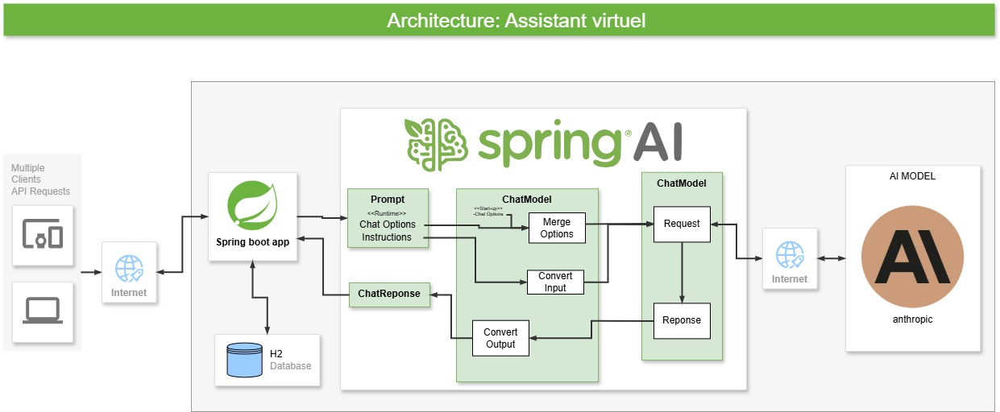

# Assistant IA pour les Démarches Administratives au Gabon

## Description
Ce projet vise à développer un assistant intelligent capable de guider les citoyens gabonais dans leurs démarches administratives. Il utilise l'intelligence artificielle générative via Spring AI pour fournir des réponses précises et personnalisées aux questions administratives.

## Fonctionnalités
- Réponses automatiques aux questions administratives
- Suggestions et guidage à travers les procédures
- Stockage des interactions pour analyse et amélioration
- Interface API REST pour intégration avec d'autres systèmes

## Technologies Utilisées
- **Spring Boot** : Framework principal pour le développement de l'application
- **Spring Data JPA** : Gestion des interactions avec la base de données
- **H2 Database** : Base de données embarquée pour le stockage temporaire
- **Spring AI** : Intégration de l'intelligence artificielle générative
- **JavaScript** : Langage de programmation essentiel du web, il apporte interactivité et dynamisme aux pages web

## Prérequis
Avant d'exécuter l'application, assurez-vous d'avoir installé les éléments suivants :
- JDK 17+
- Maven 3+
- Un environnement compatible avec Spring Boot

## Installation
1. Clonez le dépôt :
   ```sh
   git clone https://github.com/bangaromaric/spring-ai.git
   cd spring-ai
   ```
2. Compilez et exécutez l'application :
   ```sh
   mvn spring-boot:run
   ```
3. Accédez à l'API via :
   ```
   http://localhost:8080/ai/demande
   ```

## Configuration
Le fichier `application.yml` permet de configurer :
- La connexion à la base de données
- Les paramètres de l'IA
- Les logs de l'application

## API REST
L'application expose plusieurs endpoints REST pour interagir avec l'assistant IA. Voici quelques exemples :

- **Obtenir une réponse à une question**
  ```http
  GET /ai/demande?message=Comment obtenir un passeport au Gabon ?
  ```


## Contribuer
Les contributions sont les bienvenues ! Pour proposer des améliorations :
1. Forkez le projet
2. Créez une branche (`feature/amélioration`)
3. Soumettez une Pull Request

## Licence
Ce projet est sous licence MIT. Voir le fichier [LICENSE](LICENSE) pour plus d'informations.

